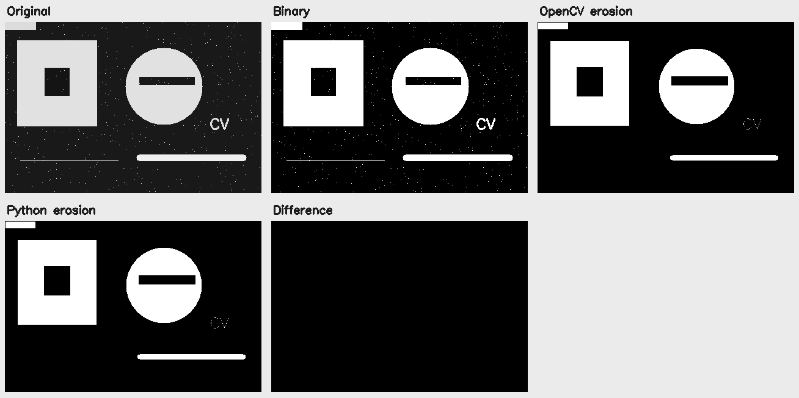
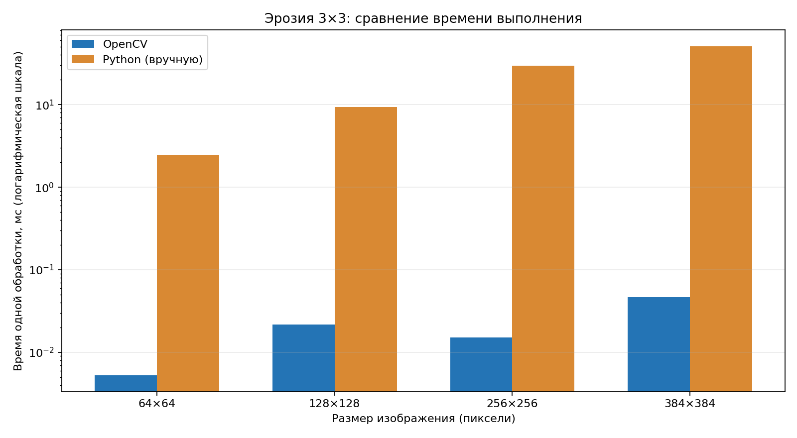

# Лабораторная работа № 1. Морфологическая эрозия изображения (вариант 7)

**Цель работы:** научиться реализовывать простой алгоритм обработки изображений, создать библиотечную и нативную реализации эрозии и сравнить их быстродействие.

**Задание:** реализовать **эрозию бинарного изображения** квадратным структурным элементом **3 × 3** в двух вариантах: с использованием OpenCV и вручную на Python; проверить совпадение результатов и сравнить скорость выполнения.

## 1. Теоретическая база

### Что такое эрозия

**Эрозия** - операция математической морфологии, которая уменьшает белые области (объекты) бинарного изображения. При этом:

- границы белых объектов сдвигаются внутрь;
- отдельные белые точки и достаточно тонкие белые линии могут исчезнуть;
- чёрные отверстия внутри белых областей увеличиваются.

В этой работе белый пиксель имеет значение **255**, а чёрный - **0**.

Для эрозии используется квадратный структурный элемент, состоящий из девяти единиц:

```text
1 1 1
1 1 1
1 1 1
```

Для каждого пикселя рассматриваются он сам и восемь соседей. Результирующий пиксель останется **белым, только если все девять пикселей белые**. Если хотя бы один из них чёрный, центральный пиксель станет чёрным.

**Математическая запись для бинарного изображения:**

$$
I_{out}(x,y) = \min_{i,j \in \{-1,0,1\}} I_{in}(x+i, y+j).
$$

То есть берём минимальное значение в окрестности 3 × 3. Поскольку в бинарном изображении возможны только 0 и 255, результат - 255 лишь тогда, когда во всём окне нет нулей.

**Пример:** если все элементы слева белые, центр справа остаётся белым:

```text
Входное окно 3×3     Выходной центральный пиксель
255 255 255           255
255 255 255     =>
255 255 255
```

Если хотя бы один из девяти пикселей чёрный, значение центрального пикселя будет 0.

**Обработка границ:** за пределами изображения принимается значение **0** (`BORDER_CONSTANT`, `borderValue=0`). Поэтому крайние строки и столбцы результата станут чёрными. В обеих реализациях используется одно и то же правило: это важно для корректного сравнения.

### Где используется эрозия

Эрозию применяют для удаления небольших светлых помех, уменьшения объектов, разделения соприкасающихся белых областей, а также как составную часть морфологических операций, например открытия.

## 2. Описание разработанной системы

### Используемые средства

- **Python 3** - основной язык программирования;
- **OpenCV (`cv2`)** - загрузка и сохранение изображений, бинаризация, библиотечная эрозия;
- **NumPy** - представление изображений и проверка результата;
- **Matplotlib** - построение графика сравнения скорости;
- **`time.perf_counter()`** - измерение времени работы алгоритмов.

### Структура проекта

```text
lab1_erosion/
├── README.md                  # Отчёт по лабораторной работе
├── requirements.txt           # Зависимости
├── erosion.py                 # Две реализации эрозии + бинаризация
├── main.py                    # Основной запуск, сохранение изображений
├── benchmark.py               # Замеры времени, таблица CSV, график
├── generate_example.py        # Генерация примера для проверки
├── examples/
│   └── input.png              # Тестовое исходное изображение
├── results/
│   ├── 01_binary.png          # Бинаризованное изображение
│   ├── 02_opencv.png          # Выход OpenCV
│   ├── 03_native.png          # Выход ручной реализации
│   ├── 04_difference.png      # Разность двух результатов
│   ├── 05_comparison.png      # Сравнение изображений в одном файле
│   ├── benchmark.csv          # Результаты измерений
│   └── benchmark.png          # График времени работы
└── tests/
    └── test_erosion.py        # Автоматические тесты
```

### Принцип работы программы

1. Загрузить изображение в оттенках серого (или создать демонстрационное).
2. Бинаризовать его при помощи `cv2.threshold()` с порогом 127 по умолчанию.
3. Обработать один и тот же бинарный вход двумя способами.
4. Сравнить результаты попиксельно. При несовпадении программа выдаст ошибку.
5. Сохранить изображения, в том числе карту различий.
6. В отдельном тесте замерить время выполнения на изображениях разных размеров и построить график.

### Реализация 1. Библиотечный вариант (OpenCV)

```python
KERNEL_3X3 = np.ones((3, 3), dtype=np.uint8)

def erosion_opencv(binary):
    return cv2.erode(
        binary,
        KERNEL_3X3,
        iterations=1,
        borderType=cv2.BORDER_CONSTANT,
        borderValue=0,
    )
```

Библиотечная функция `cv2.erode()` уже содержит реализацию алгоритма, поэтому в нашем коде требуется только задать ядро размером 3 × 3, число итераций и обработку краёв.

### Реализация 2. Нативный Python

```python
def erosion_native(binary):
    height, width = binary.shape
    source = binary.tolist()
    result = [[0] * width for _ in range(height)]

    for y in range(1, height - 1):
        for x in range(1, width - 1):
            all_white = True
            for dy in (-1, 0, 1):
                for dx in (-1, 0, 1):
                    if source[y + dy][x + dx] == 0:
                        all_white = False
                        break
                if not all_white:
                    break
            if all_white:
                result[y][x] = 255

    return np.asarray(result, dtype=np.uint8)
```

Второй алгоритм **самостоятельно** обходит все пиксели и проверяет их соседей. Он не использует `cv2.erode()` или другие готовые морфологические операции. Временные преобразования списка в NumPy и обратно включены в измерение его скорости.

Временная сложность обеих реализаций - **O(H × W × 9)**, то есть **O(H × W)** при фиксированном размере ядра 3 × 3, где *H* и *W* - высота и ширина изображения. Практическая скорость отличается из-за накладных расходов интерпретатора Python и оптимизированного нативного кода OpenCV.

### Как запустить

**Windows (PowerShell):**

```powershell
py -m venv .venv
.\.venv\Scripts\Activate.ps1
pip install -r requirements.txt
```

**Linux / macOS:**

```bash
python3 -m venv .venv
source .venv/bin/activate
pip install -r requirements.txt
```

Запустите обработку готового примера:

```bash
python main.py
```

Чтобы запустить на собственной фотографии:

```bash
python main.py --input my_photo.jpg --threshold 127 --output-dir my_results
```

Если объекты тёмные на светлом фоне, добавьте `--invert`, чтобы сделать объекты белыми перед эрозией:

```bash
python main.py --input my_photo.jpg --invert
```

Сравнение быстродействия (по умолчанию размеры 64, 128, 256, 384 и медиана 7 замеров):

```bash
python benchmark.py
```

Можно задать свои размеры изображений и количество повторов:

```bash
python benchmark.py --sizes 64 128 256 512 --repeats 10
```

Проверка корректности:

```bash
python -m unittest discover -s tests -v
```

## 3. Результаты работы и тестирования системы

### Изображения до и после эрозии

Тестовое изображение содержит белые прямоугольники, круг, внутренние чёрные отверстия, тонкие линии, надпись и отдельно расположенные белые точки (шум). Для воспроизводимости пример создаётся программно с фиксированным зерном генератора.



**Наблюдения:**

- одиночные белые точки на чёрном фоне исчезли;
- очень тонкая белая линия исчезла полностью;
- края крупных фигур стали тоньше;
- чёрные отверстия и прорези немного расширились;
- изображение «Difference» полностью чёрное, то есть различающихся пикселей **0**.

### Проверка точности

Реализовано **7 автоматических тестов**, проверяющих полностью чёрное и полностью белое изображение, одиночный белый пиксель, чёрное отверстие в белой области, изображения меньше ядра 3 × 3, случайные бинарные изображения с разной плотностью белых пикселей и правильность бинаризации.

**Все 7 тестов прошли успешно.** На всех изображениях для теста производительности обнаружено **0 различающихся пикселей** между двумя реализациями.

### Сравнение быстродействия

Условия тестирования:

- одинаковые входные изображения для обоих алгоритмов;
- бинаризация, чтение и сохранение изображений **не входят** в замер;
- на каждом размере выполнено по **7 измерений** каждого метода после одного прогревочного вызова;
- в таблице приведена **медиана времени одного вызова** в миллисекундах;
- тест выполнен в предоставленной среде с Python **3.13.5**, OpenCV **4.13.0**, NumPy **2.3.5**;
- результаты зависят от процессора, операционной системы и нагрузки, поэтому при запуске на другом ПК могут изменяться.

| Размер (пиксели) | OpenCV, мс | Python, мс | Ускорение OpenCV | Различий, пиксели |
|:---:|---:|---:|---:|---:|
| 64 × 64 | 0,0152 | 1,0982 | 72,4× | 0 |
| 128 × 128 | 0,0174 | 4,7927 | 275,9× | 0 |
| 256 × 256 | 0,0245 | 19,0357 | 776,8× | 0 |
| 384 × 384 | 0,0349 | 44,8921 | 1287,6× | 0 |



**Интерпретация графика:** вертикальная ось показана в логарифмическом масштабе, поскольку времена алгоритмов различаются на несколько порядков. С ростом количества пикселей увеличивается время обработки обоих алгоритмов. При этом OpenCV оказывается существенно быстрее за счёт реализации на скомпилированном коде и оптимизаций. Численное отношение времён зависит также от малого абсолютного времени вызова OpenCV и не должно интерпретироваться как универсальная константа ускорения.

Вся исходная таблица с большей точностью хранится в файле [`results/benchmark.csv`](results/benchmark.csv).

## 4. Выводы по работе

В ходе лабораторной работы были разработаны и проверены **две версии морфологической эрозии** бинарного изображения с квадратным ядром размером **3 × 3**: с использованием готовой функции OpenCV и нативно на Python с последовательным просмотром девяти пикселей в окрестности каждой позиции.

Обе версии дали **полностью совпадающие результаты**. Эрозия уменьшает размеры белых областей, удаляет небольшие отдельные светлые объекты, а также расширяет чёрные отверстия в белых фигурах.

Замеры на четырёх размерах изображений показали, что библиотечная реализация **работает значительно быстрее** ручной реализации на Python. Это объясняется тем, что OpenCV выполняет основную работу в оптимизированном скомпилированном коде, в отличие от вложенных циклов интерпретатора Python.

Таким образом, **цель работы достигнута:** алгоритм реализован двумя способами, корректность проверена, скорость сравнена, результаты представлены в виде изображений, таблицы и графика.

## 5. Использованные источники

1. **OpenCV Documentation - Image Filtering (`erode`)**. Описание алгоритма, ядра, параметров и обработки границ. <https://docs.opencv.org/4.x/d4/d86/group__imgproc__filter.html>
2. **OpenCV-Python Tutorials - Morphological Transformations**. Примеры применения эрозии и других морфологических операций. <https://docs.opencv.org/4.x/d9/d61/tutorial_py_morphological_ops.html>
3. **Python Documentation - `time.perf_counter()`**. Средство для измерения длительности выполнения кода. <https://docs.python.org/3/library/time.html#time.perf_counter>
4. **NumPy Documentation**. Работа с числовыми матрицами и бинарными данными. <https://numpy.org/doc/stable/>
